# 📊 NSTPConnect 2026 — Bagong Disenyo ng Database at ERD (Database Redesign & ERD Specification)

Dokumento para sa bagong structural blueprint, Entity Relationship Diagram (ERD), table definitions, at architectural improvements ng database ng **NSTPConnect 2026**.

---

## 📑 Talaan ng Nilalaman (Table of Contents)
1. [Bakit Kailangan ng Redesign? (Architecture & Gaps Analysis)](#1-bakit-kailangan-ng-redesign)
2. [Complete Mermaid ERD Diagram (Visual Relational Blueprint)](#2-complete-mermaid-erd-diagram)
3. [Mga Detalyadong Table Schemas & Modules](#3-mga-detalyadong-table-schemas--modules)
   - [Module 1: Authentication, RBAC & Profiles](#module-1-authentication-rbac--profile-management)
   - [Module 2: Compliance & CMO Requirements](#module-2-compliance--cmo-requirements)
   - [Module 3: Community Requests & Project Management](#module-3-community-requests--project-management)
   - [Module 4: Decision Support System (DSS) Matching Engine](#module-4-dss-matching-engine)
   - [Module 5: Deployment & Group Management](#module-5-deployment--team-management)
   - [Module 6: Attendance, Hours & Make-Up Sessions](#module-6-attendance-hours-tracking--make-up)
   - [Module 7: Notifications, Audit Logs & Announcements](#module-7-notifications-audit-logs--announcements)
4. [Talahanayan ng Pagbabago (Old vs. New Schema Comparison)](#4-talahanayan-ng-pagbabago-old-vs-new)
5. [Database Views, Triggers & Optimization Guide](#5-database-views-triggers--optimization)
6. [Migration Plan & Rekomendasyon sa Pagpapatupad](#6-migration-plan--rekomendasyon)

---

## 1. Bakit Kailangan ng Redesign?

Sa kasalukuyang schema ng NSTPConnect, may ilang limitasyon at redundancy:
- **Kakulangan sa Partner & Admin Profiles:** Naka-focus lang ang profile table sa `student_profiles`. Walang dedicated profile table para sa `community_officials` (Barangay/LGU info, contact person, designation) at `nstp_officials` (department, staff code).
- **Hardcoded / Unnormalized Data:** Ang skills sa mga tables ay halo-halong comma-separated string (`TEXT`) o array ng raw strings (`TEXT[]`), na nagpapahirap sa exact DSS indexation at consistent matching.
- **Relasyon ng Deployments at Sessions:** Sa kasalukuyan, ang attendance ay nakadikit agad sa deployment nang walang explicit `deployment_sessions` (schedule per day/event), kaya mahirap i-validate ang multi-day scheduled rotations o exact geo-fencing per session.
- **Audit Trails & Security Logs:** Walang centralized table para sa system audit logs (sino ang nag-approve ng compliance, nag-override ng attendance, nagbago ng request status).
- **Geographic Information (GIS/Coordinates):** Kailangan ng standardized latitude/longitude columns sa parehong student profiles at community request locations para sa automated distance computation sa DSS module.

---

## 2. Complete Mermaid ERD Diagram

Nasa ibaba ang visual architecture ng bagong database structure gamit ang Mermaid relational syntax:

```mermaid
erDiagram
    %% MODULE 1: AUTH & PROFILES
    USERS ||--o| STUDENT_PROFILES : "has (1:1)"
    USERS ||--o| COMMUNITY_PROFILES : "has (1:1)"
    USERS ||--o| OFFICIAL_PROFILES : "has (1:1)"
    USERS ||--o{ OTP_VERIFICATIONS : "requests"
    USERS ||--o| NOTIFICATION_PREFERENCES : "configures"

    %% MODULE 2: COMPLIANCE
    USERS ||--o{ STUDENT_CMO_REQUIREMENTS : "submits"
    USERS ||--o{ STUDENT_CMO_REQUIREMENTS : "reviews (official)"

    %% MODULE 3: COMMUNITY REQUESTS & SKILLS
    COMMUNITY_PROFILES ||--o{ COMMUNITY_REQUESTS : "creates"
    COMMUNITY_REQUESTS ||--o{ REQUEST_REQUIRED_SKILLS : "specifies"
    SKILLS ||--o{ REQUEST_REQUIRED_SKILLS : "tagged in"
    STUDENT_PROFILES ||--o{ STUDENT_SKILLS : "possesses"
    SKILLS ||--o{ STUDENT_SKILLS : "categorized as"

    %% MODULE 4: DSS MATCHING
    COMMUNITY_REQUESTS ||--o{ DSS_MATCH_RUNS : "evaluated in"
    DSS_MATCH_RUNS ||--o{ DSS_MATCH_RESULTS : "produces"
    USERS ||--o{ DSS_MATCH_RESULTS : "ranked student"

    %% MODULE 5: DEPLOYMENTS
    COMMUNITY_REQUESTS ||--o{ DEPLOYMENTS : "fulfills"
    USERS ||--o{ DEPLOYMENTS : "managed by (official)"
    DEPLOYMENTS ||--o{ DEPLOYMENT_STUDENTS : "assigns"
    USERS ||--o{ DEPLOYMENT_STUDENTS : "assigned student"
    DEPLOYMENTS ||--o{ DEPLOYMENT_SESSIONS : "schedules"

    %% MODULE 6: ATTENDANCE & HOURS
    DEPLOYMENT_SESSIONS ||--o{ ATTENDANCE_RECORDS : "tracks"
    DEPLOYMENT_STUDENTS ||--o{ ATTENDANCE_RECORDS : "logs entry for"
    USERS ||--o{ ATTENDANCE_RECORDS : "verified by (official/partner)"
    ATTENDANCE_RECORDS ||--o| MAKE_UP_REQUESTS : "replaces"
    DEPLOYMENTS ||--o{ RENDERED_HOURS_SUMMARY : "aggregates"
    USERS ||--o{ RENDERED_HOURS_SUMMARY : "student progress"

    %% MODULE 7: NOTIFICATIONS & AUDIT
    USERS ||--o{ NOTIFICATIONS : "receives"
    USERS ||--o{ AUDIT_LOGS : "performed action"

    %% ENTITY DEFINITIONS
    USERS {
        uuid user_id PK
        varchar email UK
        text password_hash
        varchar role "student | community_official | nstp_official | admin"
        varchar account_status "pending_verification | active | inactive | blocked"
        varchar profile_status "incomplete | complete"
        varchar cmo_compliance_status "incomplete | pending_review | compliant | rejected"
        timestamptz last_login_at
        timestamptz created_at
        timestamptz updated_at
    }

    STUDENT_PROFILES {
        uuid profile_id PK
        uuid user_id FK,UK
        varchar student_number UK
        varchar first_name
        varchar middle_name
        varchar last_name
        varchar course
        varchar year_level
        varchar section
        varchar nstp_component "CWTS | LTS | ROTC"
        varchar contact_number
        date birthdate
        varchar sex "Male | Female | Other"
        text complete_address
        varchar barangay
        varchar municipality
        varchar province
        decimal latitude
        decimal longitude
        varchar emergency_contact_name
        varchar emergency_contact_number
        varchar emergency_contact_relationship
        timestamptz created_at
        timestamptz updated_at
    }

    COMMUNITY_PROFILES {
        uuid community_profile_id PK
        uuid user_id FK,UK
        varchar organization_name
        varchar official_designation
        varchar contact_person_name
        varchar contact_number
        text office_address
        varchar barangay
        varchar municipality
        varchar province
        decimal latitude
        decimal longitude
        varchar verification_document_url
        boolean is_verified
        timestamptz created_at
        timestamptz updated_at
    }

    OFFICIAL_PROFILES {
        uuid official_profile_id PK
        uuid user_id FK,UK
        varchar employee_id UK
        varchar full_name
        varchar designation
        varchar department
        varchar office_contact
        timestamptz created_at
        timestamptz updated_at
    }

    SKILLS {
        uuid skill_id PK
        varchar skill_name UK
        varchar skill_category "Technical | Health | Teaching | Environmental | Admin | Others"
        text description
    }

    STUDENT_SKILLS {
        uuid id PK
        uuid student_profile_id FK
        uuid skill_id FK
        varchar proficiency_level "Beginner | Intermediate | Advanced"
    }

    STUDENT_CMO_REQUIREMENTS {
        uuid requirement_id PK
        uuid student_user_id FK
        varchar requirement_type "notarized_parent_waiver | validated_student_id | valid_parent_id | medical_certificate"
        varchar file_name
        text file_url
        text file_path
        varchar file_type
        integer file_size
        varchar status "pending | approved | rejected | resubmitted"
        text rejection_reason
        uuid reviewed_by FK
        timestamptz reviewed_at
        timestamptz uploaded_at
        timestamptz updated_at
    }

    COMMUNITY_REQUESTS {
        uuid request_id PK
        uuid community_user_id FK
        varchar activity_title
        text activity_description
        varchar activity_type
        varchar preferred_nstp_component "CWTS | LTS | Both"
        integer students_needed
        date preferred_start_date
        date preferred_end_date
        varchar schedule_description
        varchar urgency_level "Low | Medium | High | Urgent"
        text target_beneficiaries
        text special_instructions
        varchar location_barangay
        varchar location_municipality
        varchar location_province
        decimal location_lat
        decimal location_lng
        varchar request_status "draft | pending | approved | rejected | ongoing | completed | cancelled"
        text review_notes
        uuid reviewed_by FK
        timestamptz reviewed_at
        timestamptz created_at
        timestamptz updated_at
    }

    REQUEST_REQUIRED_SKILLS {
        uuid id PK
        uuid request_id FK
        uuid skill_id FK
        boolean is_mandatory
    }

    DSS_MATCH_RUNS {
        uuid run_id PK
        uuid request_id FK
        uuid executed_by FK
        jsonb criteria_weights
        integer total_candidates_evaluated
        timestamptz executed_at
    }

    DSS_MATCH_RESULTS {
        uuid result_id PK
        uuid run_id FK
        uuid request_id FK
        uuid student_user_id FK
        decimal overall_score
        varchar match_tier "Highly Recommended | Recommended | Possible Match | Low Match"
        integer rank_position
        decimal score_location
        decimal score_skills
        decimal score_component
        decimal score_availability
        decimal distance_in_km
        timestamptz created_at
    }

    DEPLOYMENTS {
        uuid deployment_id PK
        uuid request_id FK
        varchar deployment_code UK
        varchar batch_title
        varchar deployment_status "pending | active | ongoing | completed | cancelled"
        date start_date
        date end_date
        decimal required_hours_per_student
        uuid coordinator_id FK
        text coordinator_notes
        timestamptz created_at
        timestamptz updated_at
    }

    DEPLOYMENT_STUDENTS {
        uuid deployment_student_id PK
        uuid deployment_id FK
        uuid student_user_id FK
        varchar student_role "Member | Team Leader | Assistant Leader"
        varchar assignment_status "assigned | active | completed | pulled_out | replaced"
        timestamptz assigned_at
        timestamptz updated_at
    }

    DEPLOYMENT_SESSIONS {
        uuid session_id PK
        uuid deployment_id FK
        varchar session_title
        date session_date
        time expected_start_time
        time expected_end_time
        decimal credited_hours
        text venue_address
        decimal venue_lat
        decimal venue_lng
        varchar session_status "scheduled | ongoing | completed | cancelled"
    }

    ATTENDANCE_RECORDS {
        uuid attendance_id PK
        uuid session_id FK
        uuid deployment_student_id FK
        date attendance_date
        timestamptz check_in_time
        timestamptz check_out_time
        decimal check_in_lat
        decimal check_in_lng
        text check_in_photo_url
        varchar attendance_status "present | late | absent | excused | make_up_applied"
        decimal rendered_hours
        uuid verified_by FK
        timestamptz verified_at
        text student_remarks
        text official_remarks
        timestamptz created_at
        timestamptz updated_at
    }

    MAKE_UP_REQUESTS {
        uuid make_up_id PK
        uuid attendance_id FK,UK
        uuid student_user_id FK
        uuid deployment_id FK
        text reason_for_absence
        text excuse_document_url
        date proposed_date
        time proposed_start_time
        time proposed_end_time
        varchar request_status "pending | approved | rejected | rendered | verified"
        uuid reviewed_by FK
        timestamptz reviewed_at
        text reviewer_remarks
        decimal credited_hours
        timestamptz created_at
        timestamptz updated_at
    }

    RENDERED_HOURS_SUMMARY {
        uuid summary_id PK
        uuid deployment_id FK
        uuid student_user_id FK
        decimal total_required_hours
        decimal total_verified_hours
        decimal total_pending_hours
        integer sessions_present
        integer sessions_late
        integer sessions_absent
        integer sessions_excused
        integer makeup_completed
        decimal completion_percentage
        varchar completion_status "in_progress | completed | deficient"
        timestamptz updated_at
    }

    NOTIFICATIONS {
        uuid notification_id PK
        uuid recipient_user_id FK
        varchar notification_type
        varchar title
        text message
        varchar priority "low | normal | high | urgent"
        boolean is_read
        timestamptz read_at
        text action_url
        varchar action_label
        uuid reference_id
        varchar reference_type
        timestamptz created_at
    }

    AUDIT_LOGS {
        uuid log_id PK
        uuid performed_by FK
        varchar action_type "CREATE | UPDATE | DELETE | APPROVE | REJECT | OVERRIDE"
        varchar target_entity "users | requests | deployments | attendance | requirements"
        uuid target_id
        jsonb old_values
        jsonb new_values
        varchar ip_address
        text user_agent
        timestamptz created_at
    }
```



---

## 3. Mga Detalyadong Table Schemas & Modules

### Module 1: Authentication, RBAC & Profile Management

```sql
-- 1.1 Core Users Table
CREATE TABLE users (
    user_id UUID PRIMARY KEY DEFAULT gen_random_uuid(),
    email VARCHAR(255) UNIQUE NOT NULL,
    password_hash TEXT NOT NULL,
    role VARCHAR(30) NOT NULL CHECK (role IN ('student', 'community_official', 'nstp_official', 'admin')),
    account_status VARCHAR(30) NOT NULL DEFAULT 'pending_verification' 
        CHECK (account_status IN ('pending_verification', 'active', 'inactive', 'blocked')),
    profile_status VARCHAR(30) NOT NULL DEFAULT 'incomplete' 
        CHECK (profile_status IN ('incomplete', 'complete')),
    cmo_compliance_status VARCHAR(30) NOT NULL DEFAULT 'incomplete' 
        CHECK (cmo_compliance_status IN ('incomplete', 'pending_review', 'compliant', 'rejected')),
    last_login_at TIMESTAMPTZ,
    created_at TIMESTAMPTZ NOT NULL DEFAULT NOW(),
    updated_at TIMESTAMPTZ NOT NULL DEFAULT NOW()
);

-- 1.2 Student Profiles Table
CREATE TABLE student_profiles (
    profile_id UUID PRIMARY KEY DEFAULT gen_random_uuid(),
    user_id UUID NOT NULL UNIQUE REFERENCES users(user_id) ON DELETE CASCADE,
    student_number VARCHAR(100) UNIQUE NOT NULL,
    first_name VARCHAR(100) NOT NULL,
    middle_name VARCHAR(100),
    last_name VARCHAR(100) NOT NULL,
    course VARCHAR(150) NOT NULL,
    year_level VARCHAR(30) NOT NULL,
    section VARCHAR(50) NOT NULL,
    nstp_component VARCHAR(20) NOT NULL CHECK (nstp_component IN ('CWTS', 'LTS', 'ROTC')),
    contact_number VARCHAR(20) NOT NULL,
    birthdate DATE NOT NULL,
    sex VARCHAR(10) CHECK (sex IN ('Male', 'Female', 'Other')),
    complete_address TEXT NOT NULL,
    barangay VARCHAR(100) NOT NULL,
    municipality VARCHAR(100) NOT NULL,
    province VARCHAR(100) NOT NULL,
    latitude DECIMAL(10, 8),
    longitude DECIMAL(11, 8),
    emergency_contact_name VARCHAR(255) NOT NULL,
    emergency_contact_number VARCHAR(20) NOT NULL,
    emergency_contact_relationship VARCHAR(100) NOT NULL,
    created_at TIMESTAMPTZ NOT NULL DEFAULT NOW(),
    updated_at TIMESTAMPTZ NOT NULL DEFAULT NOW()
);

-- 1.3 Community Partner Profiles Table
CREATE TABLE community_profiles (
    community_profile_id UUID PRIMARY KEY DEFAULT gen_random_uuid(),
    user_id UUID NOT NULL UNIQUE REFERENCES users(user_id) ON DELETE CASCADE,
    organization_name VARCHAR(255) NOT NULL,
    official_designation VARCHAR(150) NOT NULL,
    contact_person_name VARCHAR(255) NOT NULL,
    contact_number VARCHAR(20) NOT NULL,
    office_address TEXT NOT NULL,
    barangay VARCHAR(100) NOT NULL,
    municipality VARCHAR(100) NOT NULL,
    province VARCHAR(100) NOT NULL,
    latitude DECIMAL(10, 8),
    longitude DECIMAL(11, 8),
    verification_document_url TEXT,
    is_verified BOOLEAN DEFAULT FALSE,
    created_at TIMESTAMPTZ NOT NULL DEFAULT NOW(),
    updated_at TIMESTAMPTZ NOT NULL DEFAULT NOW()
);

-- 1.4 NSTP Official / Coordinator Profiles Table
CREATE TABLE official_profiles (
    official_profile_id UUID PRIMARY KEY DEFAULT gen_random_uuid(),
    user_id UUID NOT NULL UNIQUE REFERENCES users(user_id) ON DELETE CASCADE,
    employee_id VARCHAR(100) UNIQUE NOT NULL,
    full_name VARCHAR(255) NOT NULL,
    designation VARCHAR(150) NOT NULL,
    department VARCHAR(150) NOT NULL,
    office_contact VARCHAR(50),
    created_at TIMESTAMPTZ NOT NULL DEFAULT NOW(),
    updated_at TIMESTAMPTZ NOT NULL DEFAULT NOW()
);
```

---

### Module 2: Compliance & CMO Requirements

```sql
-- 2.1 Student CMO Requirements Table
CREATE TABLE student_cmo_requirements (
    requirement_id UUID PRIMARY KEY DEFAULT gen_random_uuid(),
    student_user_id UUID NOT NULL REFERENCES users(user_id) ON DELETE CASCADE,
    requirement_type VARCHAR(50) NOT NULL CHECK (requirement_type IN (
        'notarized_parent_waiver',
        'validated_student_id', 
        'valid_parent_id',
        'medical_certificate'
    )),
    file_name VARCHAR(255) NOT NULL,
    file_url TEXT NOT NULL,
    file_path TEXT NOT NULL,
    file_type VARCHAR(50) NOT NULL,
    file_size INTEGER NOT NULL,
    status VARCHAR(30) NOT NULL DEFAULT 'pending' CHECK (status IN (
        'pending', 
        'approved', 
        'rejected', 
        'resubmitted'
    )),
    rejection_reason TEXT,
    reviewed_by UUID REFERENCES users(user_id) ON DELETE SET NULL,
    reviewed_at TIMESTAMPTZ,
    uploaded_at TIMESTAMPTZ NOT NULL DEFAULT NOW(),
    updated_at TIMESTAMPTZ NOT NULL DEFAULT NOW(),
    UNIQUE (student_user_id, requirement_type)
);
```

---

### Module 3: Community Requests & Skills Management

```sql
-- 3.1 Standard Master Skills Lookup
CREATE TABLE skills (
    skill_id UUID PRIMARY KEY DEFAULT gen_random_uuid(),
    skill_name VARCHAR(100) UNIQUE NOT NULL,
    skill_category VARCHAR(50) NOT NULL DEFAULT 'General',
    description TEXT
);

-- 3.2 Student Skills Pivot
CREATE TABLE student_skills (
    id UUID PRIMARY KEY DEFAULT gen_random_uuid(),
    student_profile_id UUID NOT NULL REFERENCES student_profiles(profile_id) ON DELETE CASCADE,
    skill_id UUID NOT NULL REFERENCES skills(skill_id) ON DELETE CASCADE,
    proficiency_level VARCHAR(30) DEFAULT 'Intermediate' CHECK (proficiency_level IN ('Beginner', 'Intermediate', 'Advanced')),
    UNIQUE (student_profile_id, skill_id)
);

-- 3.3 Community Project Requests Table
CREATE TABLE community_requests (
    request_id UUID PRIMARY KEY DEFAULT gen_random_uuid(),
    community_user_id UUID NOT NULL REFERENCES users(user_id) ON DELETE CASCADE,
    activity_title VARCHAR(255) NOT NULL,
    activity_description TEXT NOT NULL,
    activity_type VARCHAR(100) NOT NULL,
    preferred_nstp_component VARCHAR(20) NOT NULL CHECK (preferred_nstp_component IN ('CWTS', 'LTS', 'Both')),
    students_needed INTEGER NOT NULL CHECK (students_needed > 0),
    preferred_start_date DATE NOT NULL,
    preferred_end_date DATE NOT NULL CHECK (preferred_end_date >= preferred_start_date),
    schedule_description VARCHAR(255) NOT NULL,
    urgency_level VARCHAR(20) NOT NULL DEFAULT 'Medium' CHECK (urgency_level IN ('Low', 'Medium', 'High', 'Urgent')),
    target_beneficiaries VARCHAR(255) NOT NULL,
    special_instructions TEXT,
    location_barangay VARCHAR(100) NOT NULL,
    location_municipality VARCHAR(100) NOT NULL,
    location_province VARCHAR(100) NOT NULL,
    location_lat DECIMAL(10, 8),
    location_lng DECIMAL(11, 8),
    request_status VARCHAR(30) NOT NULL DEFAULT 'pending' CHECK (request_status IN (
        'draft', 'pending', 'approved', 'rejected', 'ongoing', 'completed', 'cancelled'
    )),
    review_notes TEXT,
    reviewed_by UUID REFERENCES users(user_id) ON DELETE SET NULL,
    reviewed_at TIMESTAMPTZ,
    created_at TIMESTAMPTZ NOT NULL DEFAULT NOW(),
    updated_at TIMESTAMPTZ NOT NULL DEFAULT NOW()
);

-- 3.4 Request Skills Requirements Pivot
CREATE TABLE request_required_skills (
    id UUID PRIMARY KEY DEFAULT gen_random_uuid(),
    request_id UUID NOT NULL REFERENCES community_requests(request_id) ON DELETE CASCADE,
    skill_id UUID NOT NULL REFERENCES skills(skill_id) ON DELETE CASCADE,
    is_mandatory BOOLEAN DEFAULT TRUE,
    UNIQUE (request_id, skill_id)
);
```

---

### Module 4: DSS Matching Engine

```sql
-- 4.1 DSS Execution Run Batches
CREATE TABLE dss_match_runs (
    run_id UUID PRIMARY KEY DEFAULT gen_random_uuid(),
    request_id UUID NOT NULL REFERENCES community_requests(request_id) ON DELETE CASCADE,
    executed_by UUID NOT NULL REFERENCES users(user_id),
    criteria_weights JSONB NOT NULL DEFAULT '{"location": 0.35, "skills": 0.35, "component": 0.20, "availability": 0.10}',
    total_candidates_evaluated INTEGER NOT NULL DEFAULT 0,
    executed_at TIMESTAMPTZ NOT NULL DEFAULT NOW()
);

-- 4.2 DSS Candidate Recommendations Results
CREATE TABLE dss_match_results (
    result_id UUID PRIMARY KEY DEFAULT gen_random_uuid(),
    run_id UUID NOT NULL REFERENCES dss_match_runs(run_id) ON DELETE CASCADE,
    request_id UUID NOT NULL REFERENCES community_requests(request_id) ON DELETE CASCADE,
    student_user_id UUID NOT NULL REFERENCES users(user_id) ON DELETE CASCADE,
    overall_score DECIMAL(5, 2) NOT NULL CHECK (overall_score >= 0 AND overall_score <= 100),
    match_tier VARCHAR(50) NOT NULL CHECK (match_tier IN ('Highly Recommended', 'Recommended', 'Possible Match', 'Low Match')),
    rank_position INTEGER NOT NULL CHECK (rank_position > 0),
    score_location DECIMAL(5, 2) DEFAULT 0,
    score_skills DECIMAL(5, 2) DEFAULT 0,
    score_component DECIMAL(5, 2) DEFAULT 0,
    score_availability DECIMAL(5, 2) DEFAULT 0,
    distance_in_km DECIMAL(6, 2),
    created_at TIMESTAMPTZ NOT NULL DEFAULT NOW(),
    UNIQUE (run_id, student_user_id),
    UNIQUE (run_id, rank_position)
);
```

---

### Module 5: Deployment & Team Management

```sql
-- 5.1 Deployment Batches
CREATE TABLE deployments (
    deployment_id UUID PRIMARY KEY DEFAULT gen_random_uuid(),
    request_id UUID NOT NULL REFERENCES community_requests(request_id) ON DELETE RESTRICT,
    deployment_code VARCHAR(50) UNIQUE NOT NULL,
    batch_title VARCHAR(255) NOT NULL,
    deployment_status VARCHAR(30) NOT NULL DEFAULT 'pending' CHECK (deployment_status IN (
        'pending', 'active', 'ongoing', 'completed', 'cancelled'
    )),
    start_date DATE NOT NULL,
    end_date DATE NOT NULL CHECK (end_date >= start_date),
    required_hours_per_student DECIMAL(5, 2) NOT NULL DEFAULT 54.00,
    coordinator_id UUID NOT NULL REFERENCES users(user_id),
    coordinator_notes TEXT,
    created_at TIMESTAMPTZ NOT NULL DEFAULT NOW(),
    updated_at TIMESTAMPTZ NOT NULL DEFAULT NOW()
);

-- 5.2 Student Deployment Assignments
CREATE TABLE deployment_students (
    deployment_student_id UUID PRIMARY KEY DEFAULT gen_random_uuid(),
    deployment_id UUID NOT NULL REFERENCES deployments(deployment_id) ON DELETE CASCADE,
    student_user_id UUID NOT NULL REFERENCES users(user_id) ON DELETE CASCADE,
    student_role VARCHAR(50) NOT NULL DEFAULT 'Member' CHECK (student_role IN ('Member', 'Team Leader', 'Assistant Leader')),
    assignment_status VARCHAR(30) NOT NULL DEFAULT 'assigned' CHECK (assignment_status IN (
        'assigned', 'active', 'completed', 'pulled_out', 'replaced'
    )),
    assigned_at TIMESTAMPTZ NOT NULL DEFAULT NOW(),
    updated_at TIMESTAMPTZ NOT NULL DEFAULT NOW(),
    UNIQUE (deployment_id, student_user_id)
);

-- 5.3 Deployment Schedule Sessions (NEW)
CREATE TABLE deployment_sessions (
    session_id UUID PRIMARY KEY DEFAULT gen_random_uuid(),
    deployment_id UUID NOT NULL REFERENCES deployments(deployment_id) ON DELETE CASCADE,
    session_title VARCHAR(255) NOT NULL,
    session_date DATE NOT NULL,
    expected_start_time TIME NOT NULL,
    expected_end_time TIME NOT NULL,
    credited_hours DECIMAL(5, 2) NOT NULL DEFAULT 8.00,
    venue_address TEXT NOT NULL,
    venue_lat DECIMAL(10, 8),
    venue_lng DECIMAL(11, 8),
    session_status VARCHAR(30) NOT NULL DEFAULT 'scheduled' CHECK (session_status IN (
        'scheduled', 'ongoing', 'completed', 'cancelled'
    ))
);
```

---

### Module 6: Attendance, Hours Tracking & Make-Up

```sql
-- 6.1 Individual Attendance Records
CREATE TABLE attendance_records (
    attendance_id UUID PRIMARY KEY DEFAULT gen_random_uuid(),
    session_id UUID REFERENCES deployment_sessions(session_id) ON DELETE SET NULL,
    deployment_student_id UUID NOT NULL REFERENCES deployment_students(deployment_student_id) ON DELETE CASCADE,
    attendance_date DATE NOT NULL,
    check_in_time TIMESTAMPTZ,
    check_out_time TIMESTAMPTZ,
    check_in_lat DECIMAL(10, 8),
    check_in_lng DECIMAL(11, 8),
    check_in_photo_url TEXT,
    attendance_status VARCHAR(30) NOT NULL DEFAULT 'absent' CHECK (attendance_status IN (
        'present', 'late', 'absent', 'excused', 'make_up_applied'
    )),
    rendered_hours DECIMAL(5, 2) DEFAULT 0 CHECK (rendered_hours >= 0),
    verified_by UUID REFERENCES users(user_id) ON DELETE SET NULL,
    verified_at TIMESTAMPTZ,
    student_remarks TEXT,
    official_remarks TEXT,
    created_at TIMESTAMPTZ NOT NULL DEFAULT NOW(),
    updated_at TIMESTAMPTZ NOT NULL DEFAULT NOW(),
    UNIQUE (deployment_student_id, attendance_date)
);

-- 6.2 Make-Up Requests
CREATE TABLE make_up_requests (
    make_up_id UUID PRIMARY KEY DEFAULT gen_random_uuid(),
    attendance_id UUID NOT NULL UNIQUE REFERENCES attendance_records(attendance_id) ON DELETE CASCADE,
    student_user_id UUID NOT NULL REFERENCES users(user_id) ON DELETE CASCADE,
    deployment_id UUID NOT NULL REFERENCES deployments(deployment_id) ON DELETE CASCADE,
    reason_for_absence TEXT NOT NULL,
    excuse_document_url TEXT,
    proposed_date DATE NOT NULL,
    proposed_start_time TIME NOT NULL,
    proposed_end_time TIME NOT NULL,
    request_status VARCHAR(30) NOT NULL DEFAULT 'pending' CHECK (request_status IN (
        'pending', 'approved', 'rejected', 'rendered', 'verified'
    )),
    reviewed_by UUID REFERENCES users(user_id) ON DELETE SET NULL,
    reviewed_at TIMESTAMPTZ,
    reviewer_remarks TEXT,
    credited_hours DECIMAL(5, 2) DEFAULT 0,
    created_at TIMESTAMPTZ NOT NULL DEFAULT NOW(),
    updated_at TIMESTAMPTZ NOT NULL DEFAULT NOW()
);

-- 6.3 Rendered Hours Summary Aggregates
CREATE TABLE rendered_hours_summary (
    summary_id UUID PRIMARY KEY DEFAULT gen_random_uuid(),
    deployment_id UUID NOT NULL REFERENCES deployments(deployment_id) ON DELETE CASCADE,
    student_user_id UUID NOT NULL REFERENCES users(user_id) ON DELETE CASCADE,
    total_required_hours DECIMAL(5, 2) NOT NULL DEFAULT 54.00,
    total_verified_hours DECIMAL(5, 2) NOT NULL DEFAULT 0.00,
    total_pending_hours DECIMAL(5, 2) NOT NULL DEFAULT 0.00,
    sessions_present INTEGER NOT NULL DEFAULT 0,
    sessions_late INTEGER NOT NULL DEFAULT 0,
    sessions_absent INTEGER NOT NULL DEFAULT 0,
    sessions_excused INTEGER NOT NULL DEFAULT 0,
    makeup_completed INTEGER NOT NULL DEFAULT 0,
    completion_percentage DECIMAL(5, 2) NOT NULL DEFAULT 0.00,
    completion_status VARCHAR(30) NOT NULL DEFAULT 'in_progress' CHECK (completion_status IN (
        'in_progress', 'completed', 'deficient'
    )),
    updated_at TIMESTAMPTZ NOT NULL DEFAULT NOW(),
    UNIQUE (deployment_id, student_user_id)
);
```

---

### Module 7: Notifications, Audit Logs & Announcements

```sql
-- 7.1 System Notifications Table
CREATE TABLE notifications (
    notification_id UUID PRIMARY KEY DEFAULT gen_random_uuid(),
    recipient_user_id UUID NOT NULL REFERENCES users(user_id) ON DELETE CASCADE,
    notification_type VARCHAR(50) NOT NULL,
    title VARCHAR(255) NOT NULL,
    message TEXT NOT NULL,
    priority VARCHAR(20) NOT NULL DEFAULT 'normal' CHECK (priority IN ('low', 'normal', 'high', 'urgent')),
    is_read BOOLEAN NOT NULL DEFAULT FALSE,
    read_at TIMESTAMPTZ,
    action_url TEXT,
    action_label VARCHAR(100),
    reference_id UUID,
    reference_type VARCHAR(50),
    created_at TIMESTAMPTZ NOT NULL DEFAULT NOW()
);

-- 7.2 User Notification Preferences
CREATE TABLE notification_preferences (
    preference_id UUID PRIMARY KEY DEFAULT gen_random_uuid(),
    user_id UUID NOT NULL UNIQUE REFERENCES users(user_id) ON DELETE CASCADE,
    email_enabled BOOLEAN DEFAULT TRUE,
    in_app_enabled BOOLEAN DEFAULT TRUE,
    deployment_alerts BOOLEAN DEFAULT TRUE,
    attendance_reminders BOOLEAN DEFAULT TRUE,
    compliance_updates BOOLEAN DEFAULT TRUE,
    system_announcements BOOLEAN DEFAULT TRUE,
    created_at TIMESTAMPTZ NOT NULL DEFAULT NOW(),
    updated_at TIMESTAMPTZ NOT NULL DEFAULT NOW()
);

-- 7.3 System Audit Logs Table (NEW for Security & ISO/CHED Compliance)
CREATE TABLE audit_logs (
    log_id UUID PRIMARY KEY DEFAULT gen_random_uuid(),
    performed_by UUID REFERENCES users(user_id) ON DELETE SET NULL,
    action_type VARCHAR(30) NOT NULL CHECK (action_type IN ('CREATE', 'UPDATE', 'DELETE', 'APPROVE', 'REJECT', 'OVERRIDE', 'LOGIN', 'LOGOUT')),
    target_entity VARCHAR(50) NOT NULL,
    target_id UUID,
    old_values JSONB,
    new_values JSONB,
    ip_address VARCHAR(45),
    user_agent TEXT,
    created_at TIMESTAMPTZ NOT NULL DEFAULT NOW()
);
```

---

## 4. Talahanayan ng Pagbabago (Old vs. New)

| Katangian / Table | Lumang Disenyo (Current) | Bagong Disenyo (Redesigned) | Benepisyo (Advantage) |
| :--- | :--- | :--- | :--- |
| **Partner & Admin Profiles** | Walang dedicated tables; nakasalalay sa raw user columns o student table. | May `community_profiles` at `official_profiles`. | Kumpletong metadata para sa mga opisyal ng barangay at coordinators. |
| **Skills Handling** | `TEXT` string o `TEXT[]` array sa `student_profiles` at `community_requests`. | Master table `skills` + junction tables `student_skills` at `request_required_skills`. | Mas mabilis, eksakto, at scalable ang multi-criteria matching ng DSS. |
| **Deployment Sessions** | Walang session table; rekta dates lang sa deployment batch. | May `deployment_schedules / deployment_sessions`. | Sinusuportahan ang multi-day field visits na may hiwalay na venue, oras, at credit hours. |
| **Attendance Geofencing** | Simple time calculation lang. | May coordinates (`lat/lng`) at `check_in_photo_url` para sa tamper-proof verification. | Pinipigilan ang attendance fraud habang nasa community field. |
| **DSS Traceability** | `dss_match_results` lang ang naitatala. | May `dss_match_runs` na nagtatala ng criteria weights at run history. | Mas malinaw ang audit trail at accuracy benchmarks ng matching engine. |
| **System Audit Logs** | Walang history logs kapag nag-edit o nag-reject. | May `audit_logs` table na may JSON diff (`old_values` vs `new_values`). | Sumusunod sa Data Privacy Act (DPA 2012) at institutional compliance. |

---

## 5. Database Views, Triggers & Optimization

### Recommended Composite Indexes
```sql
-- Fast query indexes
CREATE INDEX idx_student_profiles_component_mun ON student_profiles(nstp_component, municipality);
CREATE INDEX idx_attendance_records_student_date ON attendance_records(deployment_student_id, attendance_date);
CREATE INDEX idx_dss_match_results_run_score ON dss_match_results(run_id, overall_score DESC);
CREATE INDEX idx_notifications_recipient_unread ON notifications(recipient_user_id) WHERE is_read = FALSE;
CREATE INDEX idx_audit_logs_target ON audit_logs(target_entity, target_id);
```

### Auto-Update Summary Trigger
```sql
CREATE OR REPLACE FUNCTION refresh_student_hours_summary()
RETURNS TRIGGER AS $$
DECLARE
    target_student_user_id UUID;
    target_deployment_id UUID;
BEGIN
    SELECT ds.student_user_id, ds.deployment_id 
    INTO target_student_user_id, target_deployment_id
    FROM deployment_students ds
    WHERE ds.deployment_student_id = COALESCE(NEW.deployment_student_id, OLD.deployment_student_id);

    -- Calculate verified sum
    UPDATE rendered_hours_summary
    SET 
        total_verified_hours = (
            SELECT COALESCE(SUM(ar.rendered_hours), 0)
            FROM attendance_records ar
            JOIN deployment_students ds ON ar.deployment_student_id = ds.deployment_student_id
            WHERE ds.student_user_id = target_student_user_id 
              AND ds.deployment_id = target_deployment_id
              AND ar.verified_at IS NOT NULL
        ),
        total_pending_hours = (
            SELECT COALESCE(SUM(ar.rendered_hours), 0)
            FROM attendance_records ar
            JOIN deployment_students ds ON ar.deployment_student_id = ds.deployment_student_id
            WHERE ds.student_user_id = target_student_user_id 
              AND ds.deployment_id = target_deployment_id
              AND ar.verified_at IS NULL
        ),
        updated_at = NOW()
    WHERE student_user_id = target_student_user_id 
      AND deployment_id = target_deployment_id;

    RETURN COALESCE(NEW, OLD);
END;
$$ LANGUAGE plpgsql;

CREATE TRIGGER trg_refresh_hours_on_attendance
AFTER INSERT OR UPDATE OR DELETE ON attendance_records
FOR EACH ROW EXECUTE FUNCTION refresh_student_hours_summary();
```

---

## 6. Migration Plan & Rekomendasyon

1. **Step 1: Backup Current Data:** I-export ang kasalukuyang database tables gamit ang pg_dump o Supabase Backup tool.
2. **Step 2: Table Creation (DDL):** Ipatupad ang mga bagong tables (`skills`, `community_profiles`, `official_profiles`, `deployment_sessions`, `audit_logs`).
3. **Step 3: Data Migration Script:**
   - I-migrate ang existing profile records sa `community_profiles` at `official_profiles` batay sa `users.role`.
   - I-parse ang string/array skills sa `skills` at `student_skills` tables.
4. **Step 4: Update Backend Models & Repositories:** I-update ang Express controllers at Supabase queries upang gamitin ang normalized tables.
5. **Step 5: Regression & Testing:** Patakbuhin ang matching engine, attendance logging, at CMO verification para masigurong 100% stable bago ilunsad.

---
*Generated for NSTPConnect 2026 Database Engineering & Architecture Review.*
